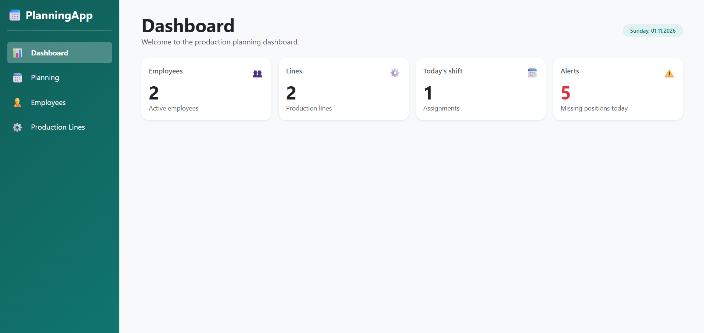
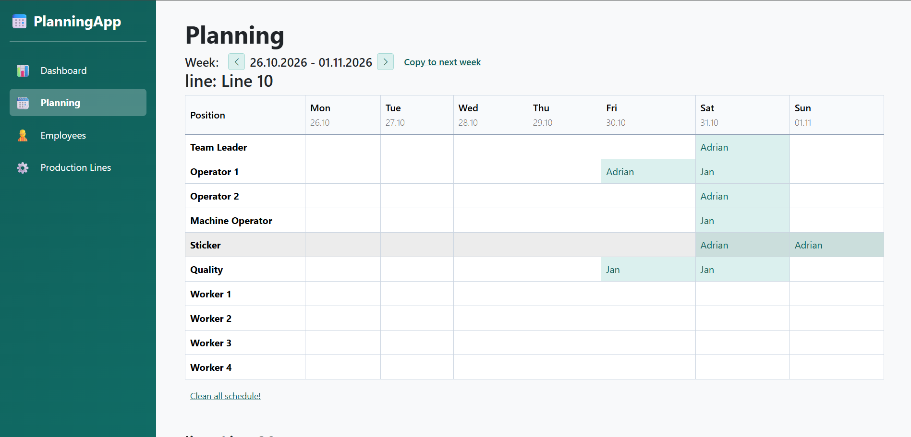
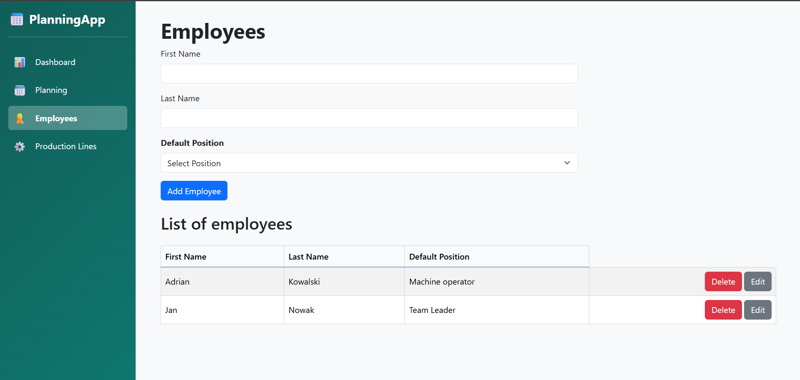
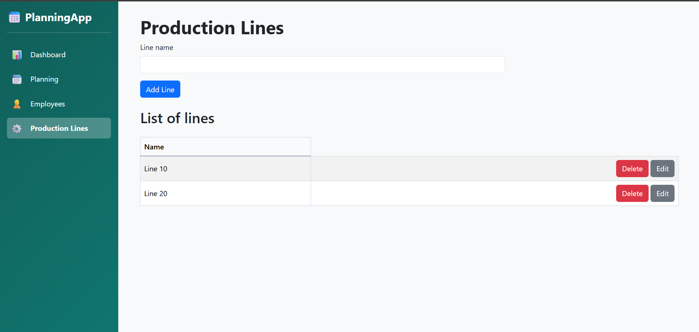

# PlanningApp

A production shift planning web app built with **Blazor (.NET 10)**. It lets a planner assign employees to positions on production lines, shift by shift and week by week, with built-in validation of scheduling rules.

This is a learning MVP built for myself, so the scope is deliberately small and focused on the core planning workflow.






## Features

- **Dashboard**: overview of employees, production lines and today's assignments
- **Weekly planner**: a table per production line and shift, with week navigation
  - assign, change and unassign employees for each position
  - copy the schedule to the next week
  - clear a single table (with confirmation)
  - the second shift table is shown only when that shift is added
- **Validation rules**
  - an employee cannot be assigned to two shifts on the same day (hard block)
  - short rest (afternoon shift followed by a morning shift the next day) shows a warning, and the planner can confirm and assign anyway
- **Employees**: add, edit, deactivate (soft delete), set a default position
- **Production lines**: add, edit, delete

## Tech stack

- .NET 10, Blazor Web App (Interactive Server)
- Entity Framework Core with SQL Server
- Bootstrap 5
- MSTest and EF Core InMemory provider for unit tests


## Getting started

### Prerequisites

- [.NET 10 SDK](https://dotnet.microsoft.com/download)
- SQL Server (LocalDB or a full instance)

### Run

```bash
git clone <repository-url>
cd PlanningApp
```

1. Set the connection string in `PlanningApp/appsettings.json` (key `DefaultConnection`), or keep your own in `appsettings.Development.json` / User Secrets.
2. Create the database:

   ```bash
   dotnet tool install --global dotnet-ef
   dotnet ef database update --project PlanningApp
   ```

3. Start the app:

   ```bash
   dotnet run --project PlanningApp
   ```

### Tests

```bash
dotnet test
```

The tests cover the short-rest validation, including the week boundary (Sunday to Monday).

## Possible next steps

- Authentication and roles
- More tests for the assignment flow
- Export of the weekly schedule
- intelligent suggestions while filling out the schedule